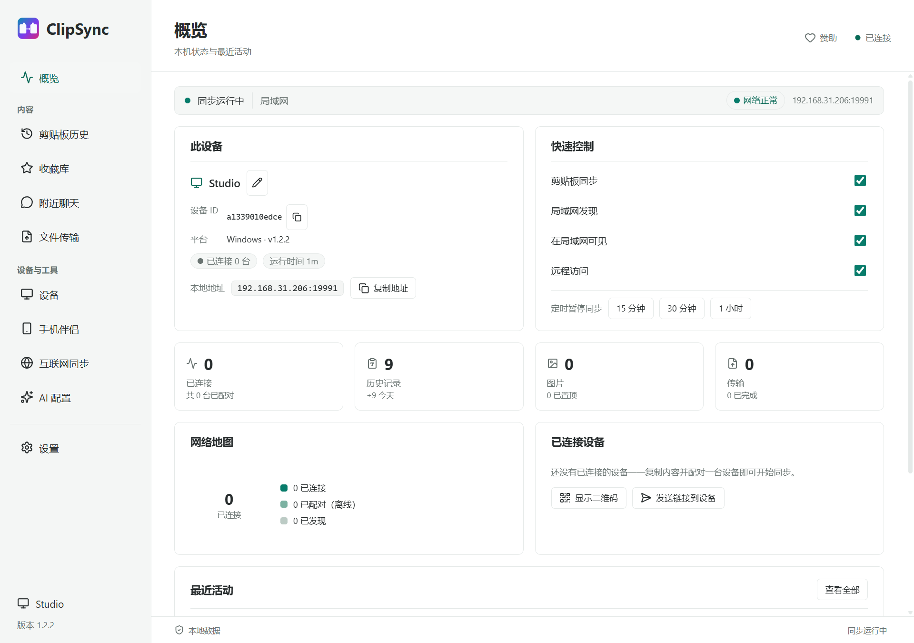

  <a href="README_en.md">English</a> &nbsp;|&nbsp;
  <a href="README.md">中文</a>

  

<h1 align="center">ClipSync</h1>

  在这台电脑复制，到那台电脑粘贴。 
  文字、图片、文件都能传，手机扫码就能接着用。

  
  

  

---

## 这是什么

ClipSync 让你在几台电脑之间自然地复制粘贴：一边复制，另一边直接粘贴。文字、图片、链接和文件都可以。

装好之后，同一个 Wi-Fi 下的电脑会自动找到对方。两台电脑不在同一个网络时，打开「互联网同步」也能继续用。手机不用装 App，用浏览器扫一下二维码就能查看和取用电脑上的内容。

不用注册账号。适合这些场景：

- 台式机和笔记本之间搬内容；
- 在公司和家里继续同一份剪贴板；
- 临时把文件从一台电脑送到另一台；
- 在手机上取电脑里的内容，或者把手机文件传回电脑；
- 保存常用回复、地址、代码片段，随时再复制出来。

第一次连接时，两台设备会显示同一个 8 位数字；确认一致后就能开始同步。以后打开 ClipSync 会自动连上。

## 下载

到 [Releases](https://github.com/kai3316/clipsync/releases/latest) 下载对应系统的安装包：

| 系统 | 安装包 |
|---|---|
| Windows 10 / 11（64 位） | `ClipSync_<版本>_x64-setup.exe` |
| macOS 12+（Apple 芯片） | `ClipSync_<版本>_aarch64.dmg` |
| macOS 12+（Intel 芯片） | `ClipSync_<版本>_x64.dmg` |
| Linux（x86_64） | `ClipSync_<版本>_amd64.deb` 或 `.AppImage` |
| Linux（ARM64） | `ClipSync_<版本>_arm64.deb` 或 `.AppImage` |

下载安装后打开就能用。macOS 第一次打开如果提示无法验证，在 Finder 里右键点击 ClipSync，选择「打开」即可。

## 第一次使用

1. 在两台设备上装好 ClipSync。
2. 连到同一个 Wi-Fi，打开 ClipSync，按屏幕提示连接；两边会显示同一个 8 位数字。
3. 在一台电脑上复制，另一台直接粘贴。

如果两台电脑不在同一个网络，在两台设备上都打开「互联网同步」，然后按提示连接即可。

## 主要功能

### 剪贴板

复制文字、图片、链接或文件，另一台电脑可以直接粘贴。剪贴板历史可以搜索、按类型筛选，也可以固定、收藏或删除。两台电脑来回复制不会重复同步。

### 收藏库

把常用的内容单独存起来，可以分组、编辑、排序，也可以导出成 Markdown。图片收藏会显示缩略图，右键可以编辑、复制或删除。

### 文件传输

把文件或文件夹拖进窗口，选一台设备就能发送。大文件不用先传网盘，同一局域网里的电脑也不用提前连接。

### 附近聊天

同一个局域网里的电脑可以直接聊天、发文件，不用先加好友。可以在设置里改成每条消息都需要手动确认。

### 手机

电脑上显示二维码，手机浏览器扫一下就能打开。可以查看历史、取内容、上传下载文件，也可以「添加到主屏幕」，以后像小应用一样使用。

### 不在同一个网络

打开「互联网同步」后，公司和家里的电脑也能继续同步；内容在设备之间加密传输。

### AI 配置

内置 Claude Code、Codex、Cursor、Gemini CLI、Windsurf、Continue 的配置管理。可以比对本机与另一台电脑的配置，再选择覆盖、另存副本或合并。

### 界面

设置里可以切换简体中文、繁體中文和 English，也可以选择跟随系统、浅色、深色、暖色、午夜或高对比主题。

## 隐私

- 同一个 Wi-Fi 下，内容在你的设备之间直接传输；
- 不在同一个网络时，内容先加密再经由中转服务转发；
- 第一次连接时核对 8 位数字；如果之后对方设备有变化，会提醒你确认；
- 可以在设置里为本地数据设置密码；
- 信用卡号、身份证号、手机号、密码等敏感内容可以选择在发送前替换为 `[FILTERED]`。

## 更新

桌面版会在「设置 → 软件更新」里检查新版本，提示后由你决定是否安装。同一局域网里另一台电脑已经升级时，也可以直接从它那里更新。

## 常见问题

两台电脑必须连同一个 Wi-Fi 吗？

不一定。同一个 Wi-Fi 下最省事；不在同一个网络时，打开「互联网同步」也能继续用。

需要注册账号吗？

不用。安装后按屏幕提示连接设备即可。

手机需要安装 App 吗？

不用。电脑上显示二维码，手机浏览器扫一下就能打开；也可以「添加到主屏幕」。

Windows 和 Mac 能互传吗？

可以。Windows、macOS、Linux 之间都能互相连接、同步剪贴板和发送文件。

关闭窗口后还会同步吗？

会。关闭窗口只是收进托盘，剪贴板同步继续运行。要真正退出，请用托盘菜单里的「退出」。

需要另外安装别的东西吗？

不需要。下载对应系统的安装包，安装后打开就能用。

历史记录怎么清理？

在设置的「安全」区域可以清空全部历史，也可以限制保留数量。收藏的内容不会被清空。

macOS 提示应用无法验证，怎么办？

在 Finder 里右键点击 ClipSync，选择「打开」，再确认一次。如果仍提示已损坏，可在终端执行：<code>xattr -dr com.apple.quarantine /Applications/ClipSync.app</code>，然后重新打开。

Linux 上剪贴板不工作？

X11 需要 <code>xclip</code>，Wayland 需要 <code>wl-clipboard</code>。使用 <code>.deb</code> 安装时通常会自动处理；使用 <code>.AppImage</code> 时可以手动安装其中一个。

ClipSync 免费吗？

个人和非商业用途免费。如果用于公司业务、收费产品或对外服务，需要先获得商业授权。

## 反馈与支持

- [Releases](https://github.com/kai3316/clipsync/releases)：版本更新和安装包
- [Issues](https://github.com/kai3316/clipsync/issues)：问题反馈
- [官网](https://kai3316.github.io/clipsync/)：功能介绍和界面截图
- [赞助](https://kai3316.github.io/clipsync/sponsor/)：支持项目继续维护

## 开发者

想从源码运行或参与开发，可以查看仓库里的 `scripts/build-tauri.ps1`、`Start-ClipSync.bat` 和 `.github/workflows/`。普通使用不需要这些。

## 许可

[PolyForm Noncommercial License 1.0.0](LICENSE)。个人和非商业使用免费；公司业务、收费产品、客户交付或托管服务等商业使用，需要先获得[商业授权](COMMERCIAL-LICENSE.md)。
