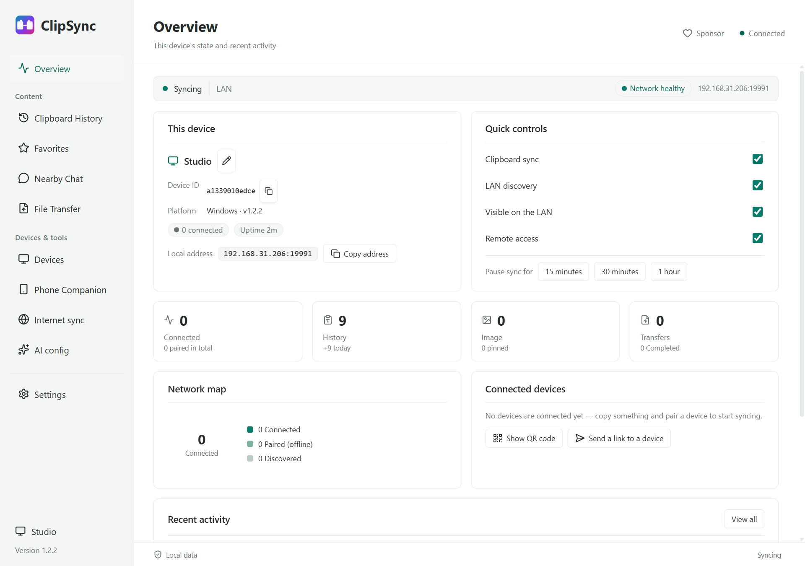

  <a href="README_en.md">English</a> &nbsp;|&nbsp;
  <a href="README.md">中文</a>

  

<h1 align="center">ClipSync</h1>

  Copy on this computer. Paste on the other one. 
  Text, pictures and files, with a phone that only needs a browser.

  
  

  

---

## What it is

ClipSync lets you copy and paste naturally between computers: copy on one, paste on another. Text, pictures, links and files all work.

Once installed, computers on the same Wi-Fi find each other automatically. When they are on different networks, turn on internet sync and keep going. Your phone does not need an app: open the QR code in a browser and use the same clipboard.

There is no account to create. It fits when you want to:

- move content between a desktop and a laptop;
- continue the same clipboard at home and at the office;
- send a file to another computer without a cloud-drive detour;
- grab something from your computer on your phone, or send a file back;
- keep replies, addresses and code snippets handy.

The first time two devices connect, both show the same 8-digit number. Check that they match and confirm; after that ClipSync reconnects on its own.

## Download

Get the installer for your system from [Releases](https://github.com/kai3316/clipsync/releases/latest):

| System | Installer |
|---|---|
| Windows 10 / 11 (64-bit) | `ClipSync_<version>_x64-setup.exe` |
| macOS 12+ (Apple silicon) | `ClipSync_<version>_aarch64.dmg` |
| macOS 12+ (Intel) | `ClipSync_<version>_x64.dmg` |
| Linux (x86_64) | `ClipSync_<version>_amd64.deb` or `.AppImage` |
| Linux (ARM64) | `ClipSync_<version>_arm64.deb` or `.AppImage` |

Download, install and open. If macOS cannot verify ClipSync on first launch, right-click it in Finder and choose Open.

## First time

1. Install ClipSync on both devices.
2. Join the same Wi-Fi, open ClipSync and follow the on-screen prompt; both devices show the same 8-digit number.
3. Copy on one computer and paste on the other.

If the computers are on different networks, turn on internet sync on both and follow the prompt to connect.

## What it does

### Clipboard

Copy text, pictures, links or files and paste them on another computer. Search and filter the history, pin it, save it as a favourite or delete it. Copying back and forth between two machines does not create duplicates.

Press `Ctrl+Shift+V` for the **quick-paste window**: type to search, pick with ↑/↓, press Enter to paste straight into the current app, `Shift+Enter` pastes plain text, `Esc` closes. `Ctrl+1`…`Ctrl+9` paste the 1st–9th recent clip directly; turn off auto-paste in Settings → Paste & Recording if you only want the clipboard filled.

Settings → Paste & Recording also lets you: skip clips marked "do not record" by password managers (1Password, Bitwarden, …); exclude source applications by substring; skip whatever was already on the clipboard at launch; and cap a single non-file clip (8 MB by default). History can be imported and exported as JSON/CSV/Markdown.

### Keyboard shortcuts

`Ctrl+Shift+V` quick-paste window; `Ctrl+1`…`Ctrl+9` paste the Nth recent clip; `Ctrl+Alt+V` copy the latest clip as plain text; `Ctrl+Shift+Space` show the main window; `Ctrl+Shift+M` pause/resume sync. All of them can be rebound in Settings → General → Global hotkeys.

### Library

Keep the things you reuse in one place: groups, editing, ordering and Markdown export. Picture favourites show a thumbnail, and right-click gives edit, copy and delete.

### File transfer

Drop files or folders on the window, choose a computer and send. No cloud drive, and computers on the same network do not need to be connected first.

Copying a file on another computer in the same network does not download it up front: the file is fetched on demand only when you paste it — from the quick-paste window or the history — with a progress panel you can cancel. The single-file limit is adjustable in Settings → Files (2 GB by default, protocol ceiling about 5.4 GB), a confirmation appears above the threshold (512 MB by default), and relay fetches over the internet are capped at 50 MB by default. When the fetch completes the file lands in the receive folder and is copied to the clipboard.

### Nearby chat

Computers on the same Wi-Fi can chat and send files without adding each other first. You can make every message require confirmation in Settings.

### Phone

Show the QR code on the computer and open it in the phone's browser. Read history, grab a clip, upload or download files, and add it to the home screen for one-tap access.

### Different networks

Turn on internet sync to keep the same clipboard at home and at the office. Content travels encrypted between the devices.

### AI configuration

Built-in profiles for Claude Code, Codex, Cursor, Gemini CLI, Windsurf and Continue. Compare the local and remote configuration, then overwrite, copy alongside or merge.

### Look and language

Choose Simplified Chinese, Traditional Chinese or English, and a theme that follows the system or picks light, dark, sepia, midnight or high contrast.

## Privacy

- On the same Wi-Fi, content moves directly between your devices;
- on different networks it is encrypted before a relay forwards it;
- the first time you connect, check the 8-digit number; if the other device changes later, you are asked to confirm;
- you can set a password for local data in Settings;
- content a password manager marks as "do not record" is never captured or synced;
- card numbers, ID numbers, phone numbers and passwords can be replaced with `[FILTERED]` before sending.

## Updates

ClipSync checks for a new version in Settings → Software update and asks before installing. If another computer on the same network has already updated, it can update from that one too.

## FAQ

Do both computers need to be on the same Wi-Fi?

No. It is easiest on the same Wi-Fi; on different networks, turn on internet sync and keep going.

Why does Ctrl+1 paste immediately?

Since 1.3 auto-paste is on by default: a shortcut puts the clip on the clipboard and pastes it into the current app. Turn off "Paste into the current app" in Settings → Paste & Recording if you only want the copy.

How do I use the quick-paste window?

Press Ctrl+Shift+V (rebindable in Settings → Global hotkeys), type to search, pick with ↑/↓ and press Enter to paste; Shift+Enter pastes plain text, Esc or a click elsewhere closes it.

Why does a file copied on the other computer take a moment to paste here?

Files are not downloaded when they are copied — that would use your disk and bandwidth for something you may not need. The file is fetched when you paste it, with progress and a cancel button. A confirmation appears above the threshold (512 MB by default), the per-file limit (2 GB by default) is adjustable in Settings → Files, and once fetched the file is saved in the receive folder and copied to the clipboard, so the next paste is instant.

Do I need an account?

No. Install ClipSync and follow the on-screen prompt to connect the devices.

Do I need an app on my phone?

No. Show the QR code on the computer and open it in the phone's browser. You can add it to the home screen.

Can Windows and Mac sync with each other?

Yes. Windows, macOS and Linux computers can connect to one another, sync the clipboard and send files.

Does it keep running when I close the window?

Yes. Closing the window puts ClipSync in the tray and sync continues. Use Quit in the tray menu to exit for real.

Do I need to install anything else first?

No. Download the installer for your system, install it and open the app.

How do I clear the history?

The Security section in Settings can clear all history and limit how much is kept. Saved favourites are not cleared.

macOS says the app cannot be verified. What should I do?

Right-click ClipSync in Finder, choose Open and confirm. If it still says the app is damaged, run <code>xattr -dr com.apple.quarantine /Applications/ClipSync.app</code> in Terminal and open it again.

Clipboard does not work on Linux?

X11 needs <code>xclip</code>, Wayland needs <code>wl-clipboard</code>. A <code>.deb</code> install usually handles it; with the <code>.AppImage</code>, install one of them manually.

Is ClipSync free?

It is free for personal and other noncommercial use. Commercial use in a company, paid product or hosted service needs a commercial license first.

## Links

- [Releases](https://github.com/kai3316/clipsync/releases): versions and installers
- [Issues](https://github.com/kai3316/clipsync/issues): bug reports
- [Website](https://kai3316.github.io/clipsync/index_en.html): screenshots and a fuller introduction
- [Support](https://kai3316.github.io/clipsync/sponsor/?lang=en): help keep the project maintained

## Development

For running from source or contributing, see `scripts/build-tauri.ps1`, `Start-ClipSync.bat` and `.github/workflows/`. You do not need any of that to use ClipSync.

## License

[PolyForm Noncommercial License 1.0.0](LICENSE). Personal and other noncommercial use is free. Commercial use — including internal business use, paid products, client projects or hosting — requires a [commercial license](COMMERCIAL-LICENSE.md).
